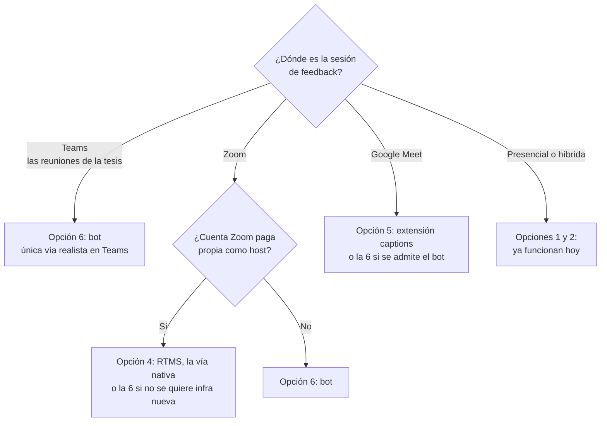

# Integración del prototipo a videollamadas: opciones

Análisis en profundidad de las vías para que el prototipo escuche reuniones reales de Zoom, Google Meet y Teams. Cuatro análisis independientes (Zoom, Meet, bots, captura local), sintetizados acá.

## La idea en una línea

El pipeline del prototipo (escucha → extractor → veredicto) solo necesita texto transcripto. Integrarse a una plataforma es cambiar la fuente de ese texto; el resto no se toca.

```mermaid
flowchart LR
    subgraph fuentes [Fuentes posibles del texto]
        WS["1. Web Speech API<br/>(hoy: micrófono local)"]
        AV["2. Audio virtual<br/>(BlackHole / VB-Cable)"]
        TAB["3. Captura de pestaña<br/>+ STT por API"]
        RTMS["4. Zoom RTMS<br/>(websocket server-side)"]
        EXT["5. Extensión Chrome<br/>(captions de Meet)"]
        BOT["6. Bot participante<br/>(Recall.ai y similares)"]
    end
    fuentes --> TXT[Texto transcripto]
    TXT --> EX[Extractor<br/>segmenta enunciados]
    EX --> BIB[Bibliotecario<br/>tool use sobre el índice]
    BIB --> V[Veredictos con citas<br/>verificadas]
```

## Comparación rápida

| # | Opción | En vivo | Diarización | Plataformas | Esfuerzo | Costo 10 h | Traba principal |
|---|--------|---------|-------------|-------------|----------|-----------|-----------------|
| 1 | Modo acompañante (hoy) | Sí | No | Todas (por el aire) | 0, ya está | USD 0 | Calidad de captura, inútil con auriculares |
| 2 | Audio virtual | Sí | No | Todas, incluso apps de escritorio | 0 código, 1 día de setup y guía | USD 0 | Frágil en vivo, solo captura el lado remoto |
| 3 | Captura de pestaña + STT API | Sí | Sí (Deepgram/AssemblyAI) | Meet y Zoom web, solo Chrome/Edge | 3 a 6 días | USD 0 con créditos gratis | La reunión tiene que correr en el navegador |
| 4 | Zoom Apps + RTMS | Sí | Sí, nativa | Solo Zoom | 4 a 6 días | USD 12 a 25 (+ Zoom Pro) | Plan pago, Developer Pack y servidor fuera de Vercel |
| 5 | Extensión captions de Meet | Sí | Sí (nombre en el DOM) | Solo Meet | 3 a 5 días | USD 0 | Scraping del DOM: se rompe cuando Google cambia el frontend |
| 6 | Bot participante | Sí | Sí | Zoom + Meet + Teams | 2 a 4 días | USD 0 a 4 con free tiers | Políticas de Teams con bots (lobby, admin del tenant) |

Conclusión transversal: el costo monetario es irrelevante (todo queda abajo de USD 25 para 10 horas de prueba). Lo que decide es la fricción administrativa de cada plataforma y dónde son las reuniones.

## Qué conviene según dónde sea la reunión

## Fichas por opción

### 1. Modo acompañante (lo que ya existe)

- El prototipo abierto en otra ventana escucha por el micrófono; en presencial capta el ambiente, en videollamada el audio tiene que salir por parlantes.
- Veredicto: es la base demostrable de la PoC, no requiere nada. Queda como piso, no como propuesta nueva.

### 2. Audio virtual (cero código)

- BlackHole (macOS) o VB-Cable (Windows) crean un micrófono virtual: la app de reunión saca el audio por ahí y la Web Speech API lo escucha tal cual, con es-AR y sin tocar una línea.
- Funciona incluso con las apps de escritorio de Zoom/Teams. Setup de 20 a 40 minutos la primera vez (Multi-Output Device en macOS para seguir oyendo la llamada).
- Limitación: el cable solo lleva el audio remoto; capturar ambos lados pide además un mezclador (Ladiocast/Voicemeeter). Y es el típico setup que falla en vivo si lo opera alguien no técnico.
- Veredicto: truco útil para las sesiones de prueba operadas por la estudiante, no una integración presentable.

### 3. Captura de pestaña + STT por API

- El usuario comparte la pestaña de Meet/Zoom web con audio (getDisplayMedia, solo Chrome/Edge) y la app recibe el audio remoto limpio; se mezcla con el micrófono local vía AudioContext para tener ambos lados.
- La Web Speech API no transcribe un stream arbitrario en su modo actual (hay una extensión nueva de Chrome con reconocimiento on-device, pero la disponibilidad de español on-device no está garantizada: vale un spike de 1 hora antes de descartarla).
- El camino firme es STT streaming por API: Deepgram (USD 200 de crédito inicial gratis, parciales de ~300 ms, diarización en streaming) o AssemblyAI (USD 50 gratis, ~USD 0,15/h). Las 10 horas de prueba salen USD 0 efectivo y la diarización viene de regalo.
- Arquitectura limpia en Vercel: el navegador se conecta directo al proveedor STT con un token efímero emitido por una ruta API; cada final del websocket reemplaza 1:1 al resultado final de SpeechRecognition.
- Riesgos: exige reunión en el navegador (no apps de escritorio, salvo Windows con pantalla completa), el usuario puede olvidar el checkbox de audio, y es Chrome/Edge only.
- Veredicto: la mejor opción sin terceros ni bots. 3 a 6 días, USD 0, y mejora el pipeline con diarización.

### 4. Zoom: Apps SDK + RTMS (la vía nativa)

- RTMS entrega transcripción ya diarizada (usuario, nombre, timestamps) en 37 idiomas, español incluido; conviene fijar src_language en español y apagar la detección automática.
- Arquitectura: app user-managed en el marketplace (sin publicar: en desarrollo alcanza para la cuenta propia) + webhook rtms_started + servidor websocket persistente con el SDK @zoom/rtms. Vercel no puede sostener ese websocket: hace falta un servicio en Railway/Fly/VPS que postee los fragmentos al pipeline actual.
- El panel lateral con Zoom Apps SDK es opcional: aporta ver los veredictos dentro de Zoom y botones start/stop, no más datos. Suma 2 días.
- Requisitos y costos: cuenta Zoom paga como host (Pro, ~USD 14/mes), Developer Pack pay-as-you-go (USD 0,02/min con transcripción: 10 horas = USD 12; hay trial de 20 créditos a verificar), y habilitación de RTMS por el admin de la cuenta.
- Riesgos: la cadena de permisos (plan pago + admin + aprobación del host) es la zona con más preguntas abiertas en el foro de Zoom; ASR distinto al actual que puede pedir recalibrar el extractor; infraestructura persistente nueva que mantener.
- Veredicto: la integración más completa y la única oficial en tiempo real de las tres plataformas, pero la de mayor fricción. 4 a 6 días. Tiene sentido si la validación se hace en Zoom con cuenta propia.

### 5. Google Meet: extensión de captions (la única vía en vivo que queda)

- Las vías oficiales están cerradas para tiempo real: la Media API sigue en developer preview y no acepta inscripciones, el Add-ons SDK embebe UI pero no da acceso a audio ni captions, y la REST API es post-reunión por diseño.
- Lo que sí funciona: una extensión Chrome que lee los subtítulos en vivo del DOM de Meet (MutationObserver) y postea cada fragmento al endpoint existente. Es la técnica de Tactiq y de varios proyectos open source. Da texto diarizado (el nombre del hablante está en el DOM), en español, gratis, con cuenta gmail común.
- Fragilidad real pero aceptable para una PoC de semanas: los selectores se rompen cuando Google actualiza el frontend; hay que manejar captions que se reescriben mientras se estabilizan.
- Plan B diferido: la REST API (conferenceRecords) devuelve transcripción diarizada con timestamps después de la reunión, para un modo "veredictos post-sesión". Requiere una licencia Workspace Business Standard o superior como organizador. 2 a 4 días.
- Veredicto: extensión de captions si la validación fuera sí o sí en Meet (3 a 5 días, USD 0); si no, el bot la cubre con menos fragilidad.

### 6. Bot participante (una integración, tres plataformas)

- Un POST con la URL de la reunión crea un bot que entra como participante; la transcripción diarizada en vivo llega por webhook, enunciado por enunciado (1 a 3 segundos de latencia). Los enunciados ya vienen segmentados por hablante: reemplazan a la Web Speech API y hasta simplifican el extractor.
- Recall.ai es el referente: USD 0,65/h todo incluido, 5 horas gratis sin tarjeta, sin mínimos. En español hay que usar el modo prioritize_accuracy (el low-latency es solo inglés) o enchufar una key propia de Deepgram. Alternativas: MeetingBaaS (8 h gratis), meetstream.ai (USD 5 de crédito: las 10 horas salen ~USD 0), Vexa (open source self-hosted, solo si los datos no pudieran salir; el montaje cuesta más días de lo que ahorra).
- Encaje con la app: para las sesiones de prueba, lo simple es correr la app local con un túnel (cloudflared/ngrok) y un buffer en memoria + SSE; en Vercel haría falta un Redis chico (Upstash free tier) como puente webhook → frontend.
- Consentimiento: el bot es visible por nombre (configurable) y el host debe admitirlo; en Zoom hay diálogo de consentimiento nativo. Para la tesis, se suma al consentimiento informado de la sesión.
- Riesgo principal: Teams. Desde 2026 retiene a los note-takers externos en el lobby por defecto y los admins pueden bloquearlos por política; verificar el tenant (ORT o el del cliente) antes de comprometerse.
- Veredicto: la mejor relación esfuerzo/resultado para demo real multiplataforma: 2 a 4 días, USD 0 a 4, y es la única vía realista en Teams, donde son las reuniones de la tesis.

## Propuesta concreta

- **Plan A (demo real en videollamada): opción 6, bot con Recall.ai.** 2 a 4 días, las 5 horas gratis cubren las sesiones de prueba, cubre Teams/Zoom/Meet con una sola integración. Primer paso barato: crear un bot por curl contra una reunión de Teams de prueba y ver si el tenant lo deja entrar (medio día, decide todo).
- **Plan B (sin terceros): opción 3, captura de pestaña + Deepgram.** USD 0 con el crédito inicial, diarización incluida, todo queda en la app propia. Limita a reuniones en el navegador.
- **Opción 4 (RTMS) queda documentada como la vía nativa de Zoom** para el capítulo de la PoC, a implementar solo si la validación se hiciera en Zoom con cuenta paga propia.
- **Sin más código, la PoC ya es demostrable** con las opciones 1 y 2 en sesiones operadas por la estudiante.
- **Dato para el capítulo:** el ecosistema es asimétrico. Zoom abrió el acceso oficial en tiempo real (RTMS, pago), Google lo mantiene cerrado (Media API sin inscripciones) y la práctica de la industria lo resuelve por los bordes: bots participantes y scraping de captions. La factibilidad de llevar validación en vivo a las reuniones depende de la plataforma, no del prototipo.

## Fuentes principales

- Zoom RTMS: https://developers.zoom.us/docs/rtms/meetings/getting-started/ , precios confirmados por staff: https://devforum.zoom.us/t/rtms-developer-pack-pricing-for-business-account/144203 , SDK: https://github.com/zoom/rtms-samples
- Vercel no sostiene websockets persistentes: https://community.vercel.com/t/does-vercel-support-websockets-now-that-we-have-fluid-compute/27205
- Meet Media API cerrada: https://developers.google.com/workspace/meet/media-api/guides/overview , Add-ons sin acceso a medios: https://discuss.google.dev/t/how-can-a-public-google-meet-add-on-access-real-time-participant-audio-without-a-bot/385365 , transcripts post-reunión: https://developers.google.com/workspace/meet/api/reference/rest/v2/conferenceRecords.transcripts.entries/list
- Extensiones de captions de Meet (técnica): https://github.com/Manuel02371/gMeetTranscriptCapture
- Recall.ai: https://www.recall.ai/pricing , transcripción en vivo: https://docs.recall.ai/docs/bot-real-time-transcription , Teams y bots 2026: https://docs.recall.ai/docs/teams-bots-bypass-the-lobby
- Alternativas de bot: https://www.meetingbaas.com/en/pricing , https://skribby.io/pricing , https://github.com/Vexa-ai/vexa
- Captura de pestaña: https://chromestatus.com/feature/5178378197139456 , Web Speech sobre MediaStreamTrack: https://developer.mozilla.org/en-US/docs/Web/API/SpeechRecognition/start
- STT streaming: https://developers.deepgram.com/reference/speech-to-text/listen-streaming , https://www.assemblyai.com/pricing , https://developers.openai.com/api/docs/pricing
