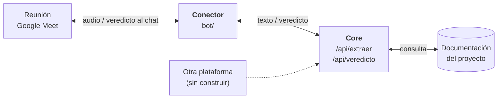
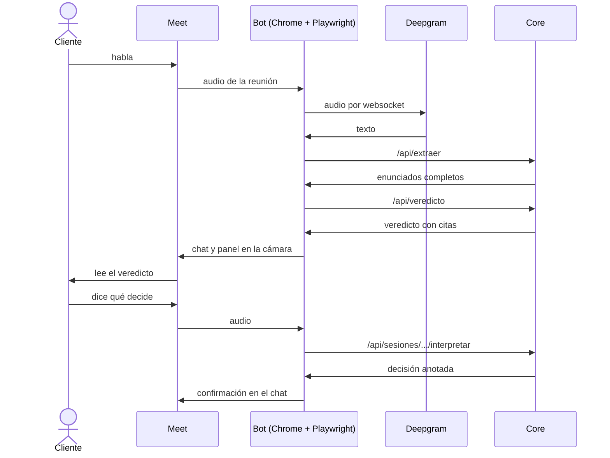

# Conector con Google Meet

El core no sabe de dónde viene el texto. El conector le lleva lo que se dice en la reunión y devuelve el veredicto a la reunión.

## Por qué Meet y un bot propio

Elegimos un solo proveedor y un bot propio, sin depender de un servicio como Recall.ai. Meet es el más simple para un bot, pero el único sin vía oficial en vivo.

| Plataforma | Vía oficial en vivo | Un bot como participante |
|---|---|---|
| **Meet** (elegida) | Ninguna: la Media API se apaga el 15/1/2027 | Sin configuración especial; uso no oficial |
| **Zoom** | RTMS, con cuenta Pro y Developer Pack | Sala de espera por defecto |
| **Teams** | Work IQ, con permiso del admin; o bot de media en Azure | Queda en el lobby como no verificado y el admin puede bloquearlo |

Fuentes, relevadas en octubre de 2026: [Meet](https://developers.google.com/workspace/meet/release-notes), [Zoom](https://developers.zoom.us/docs/rtms/meetings/), [Teams Work IQ](https://learn.microsoft.com/en-us/microsoftteams/meeting-transcript-api-access), [Teams y bots](https://techcommunity.microsoft.com/blog/microsoftteamsblog/introducing-smarter-bot-protection-in-microsoft-teams-meetings/4531375).

## Dónde está el conector

Para sumar otra plataforma se escribe otro conector; el core no cambia. La web usa los mismos endpoints con el micrófono.

## Qué es el bot

Un script de Node con TypeScript, en el repo del prototipo: [`bot/`](https://github.com/vickychappuis/prototipo-tesis/tree/main/bot). Se corre a mano con `npm run bot -- <url del Meet>`, y hasta ahora solo corrió en una máquina local.

Playwright es la biblioteca con la que ese script abre Chrome y lo maneja por código: entra a la URL, aprieta los botones y escribe en el chat.

| Archivo en `bot/src/` | Qué hace |
|---|---|
| `index.ts` | Arranca y conecta todo |
| `meet.ts` | Abre Chrome y entra a la reunión |
| `audio.ts` | Toma el audio de la reunión |
| `deepgram.ts` | Pasa el audio a texto |
| `pipeline.ts` | Manda el texto al core |
| `chat.ts` | Escribe el veredicto en el chat |
| `camara.ts` | Muestra el veredicto en la cámara del bot |

## Cómo funciona una frase

## Cómo resolvimos Meet

| Problema | Solución |
|---|---|
| Meet no tiene vía oficial en vivo | El script entra como un participante más, en un Chrome manejado por Playwright |
| Sin sesión de Google, Meet lo rechazó | Cuenta de Google logueada una vez a mano en un perfil propio del bot |
| Hay que oír la reunión | Se toman las pistas de audio que la página ya recibe (`RTCPeerConnection`) |
| El bot no debe hacer ruido | Micrófono y cámara falsos, silenciosos y apagados |
| Hay que pasar audio a texto | Deepgram por streaming, en español, con voces numeradas |
| El chat admite unos 500 caracteres | Un mensaje corto: número, sello, frase citada, motivo, pregunta y link |
| El veredicto tiene que verse grande | El panel reemplaza la cámara del bot, y se fija en Meet |
| Meet recorta el video a los costados | El panel deja márgenes laterales amplios |
| Las decisiones se dicen hablando | El core interpreta la frase, la guarda, marca la web y el chat lo confirma |
| No toda frase merece respuesta | Lo no accionable no se postea |

## Límites

- **Es un uso no oficial de Meet.** Los términos de Google prohíben eludir sus medidas de protección, por eso el bot no oculta la automatización. Aun así, la cuenta puede ser suspendida.
- **No sabe quién es el cliente.** Numera voces, pero no identifica personas ni distingue al cliente del equipo.
- **Escucha todo lo que se dice.** Hay que avisar a los participantes: que la reunión lo admita no alcanza.

## Sin probar

- Dos personas hablando
- Una reunión creada por otra persona
- Que la cámara prenda siempre: prendió en 2 de 4 entradas
- La sesión en producción: por ahora se guarda en un archivo local
