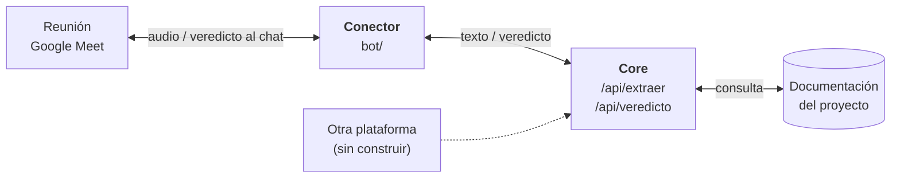
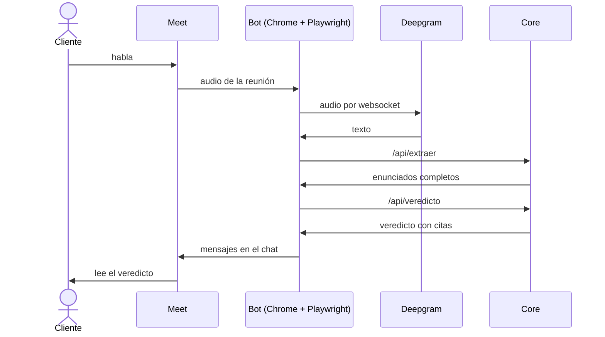

# Conector con Google Meet

El core no sabe de dónde viene el texto. El conector le lleva lo que se dice en la reunión y devuelve el veredicto a la reunión.

## Dónde está el conector

Para sumar otra plataforma se escribe otro conector; el core no cambia. La web usa los mismos endpoints con el micrófono.

## Cómo funciona una frase

## Cómo resolvimos Meet

| Problema | Solución |
|---|---|
| Meet no tiene vía oficial en vivo | El bot entra como un participante, en Chrome manejado por Playwright |
| Sin sesión de Google, Meet lo rechazó | Cuenta de Google logueada una vez a mano en un perfil propio del bot |
| Hay que oír la reunión | Se toman las pistas de audio que la página ya recibe (`RTCPeerConnection`) |
| El bot no debe hacer ruido | Micrófono y cámara falsos, silenciosos y apagados |
| Hay que pasar audio a texto | Deepgram por streaming, en español, con voces numeradas |
| El chat admite unos 500 caracteres | Dos mensajes: sello y justificación; cita y pregunta |
| No toda frase merece respuesta | Lo no accionable no se postea |

## Límites

- **Es un uso no oficial de Meet.** Los términos de Google prohíben eludir sus medidas de protección, por eso el bot no oculta la automatización. Aun así, la cuenta puede ser suspendida.
- **No sabe quién es el cliente.** Numera voces, pero no identifica personas ni distingue al cliente del equipo.
- **Escucha todo lo que se dice.** Hay que avisar a los participantes: que la reunión lo admita no alcanza.

## Sin probar

- Dos personas hablando
- Una reunión creada por otra persona
- Los dos mensajes en una reunión real
