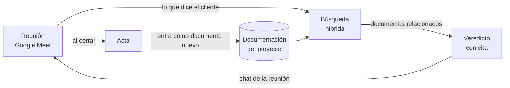

# Avance del prototipo: sprint 25

Lo acordado en la call del 19/11 para la PoC: implementar una sola forma de búsqueda y sumar un acta al final de la reunión. Las dos cosas están implementadas en el [repo del prototipo](https://github.com/vickychappuis/prototipo-tesis).



## 1. Búsqueda en la documentación

- **Elegida:** búsqueda híbrida (RAG híbrido), por la demora en vivo.
- **Cómo funciona:**
  - Cada documento se parte en fragmentos (un ítem de lista o párrafo), con el título, la sección y los datos del índice.
  - Cada fragmento se busca de dos formas: por significado (vectores) y por palabras (BM25). Los dos resultados se combinan en uno.
  - Al modelo le llegan hasta 5 documentos completos, más las 2 actas más relacionadas.
  - El veredicto sale en una sola llamada al modelo.
- **La alternativa queda como respaldo:** si la base de búsqueda no responde, el agente que navega el índice y abre los documentos sigue funcionando.
- **Si cambia un documento, se vuelve a indexar sola.**

| | Agente que navega | Búsqueda híbrida |
|---|---|---|
| Demora del veredicto (mediana) | 10,8 s | 6 s |
| Aciertos en los 15 casos de prueba | iguales | iguales |

## 2. Acta al final de la reunión

- Se genera sola al cerrar la sesión y el bot deja el enlace en el chat de la reunión.
- Formato elegido, que combina las dos opciones que vimos en la call:
  - **Resumen:** tres o cuatro frases con lo revisado, lo decidido y lo que quedó abierto.
  - **Hallazgos:** cada planteo confrontado, con su veredicto, el motivo y la decisión tomada.
  - **Transcripción:** completa, con una marca en la línea de donde salió cada hallazgo.
- Entra sola a la documentación, como un acta más, y el asistente la usa desde la reunión siguiente.
- Solo valen como acuerdos los hallazgos con decisión. La transcripción registra lo que se dijo, no lo acordado, y no se usa para buscar.
- El modelo solo escribe el resumen y los temas. Los hallazgos, las decisiones y la transcripción salen de la sesión tal cual.

Forma del acta (contenido ilustrativo):

```markdown
# Acta de reunión: 23 de noviembre de 2026

Horario: 10:02 a 10:31 · Participantes: Cliente, Equipo · Temas: prestamos, renovaciones

## Resumen
Se revisaron dos planteos sobre renovaciones. Uno se cambió y el otro quedó abierto.

## Hallazgos
**1. [10:07] CHOCA** · Cliente: "Los préstamos se renuevan dos veces"
- Motivo: lo acordado es una sola renovación.
- Decisión: se cambia (por voz: "cambiala").

## Transcripción
- [10:07] Cliente: los préstamos se renuevan dos veces ← #1
- [10:08] Equipo: lo anotamos
```

## 3. Demora de punta a punta

Desde que el cliente termina de hablar hasta que el veredicto aparece en el chat: unos 20 s, sin contar la transcripción del audio.

| Paso | Demora |
|---|---|
| Ver si es una decisión por voz | ~4 s |
| Separar los enunciados | ~4 s |
| Veredicto | ~6,7 s |
| Texto corto para el chat | ~5 s |

## Qué sigue

- Revisar la memoria organizacional del Proyecto de Ingeniería de Software (`sprint 25/MEMORIA_PIS.md`) para armar casos con documentación real.
- Definir la validación en la próxima call.
